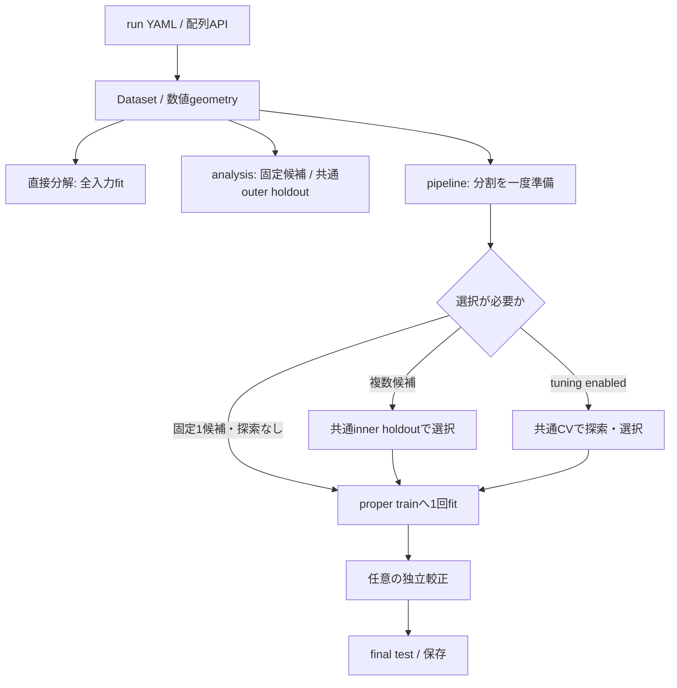

# パッケージの責務と成果物

`ml-platform-mode-decomp` 0.10 と core 0.2.1 は、一つのrun YAMLまたはPython配列から利用するパッケージです。profileと外部Dataset manifestは任意です。公開入口は `run_task(cfg) -> core.RunResult`、`FieldDataset.from_arrays()`、`FieldRepresentation`、`FieldSurrogate` を維持します。tabularや実行SDKを相互importしません。

## モジュールの境界

| 場所 | 責務 |
| --- | --- |
| config / policy / __main__ | 一つの設定解決、手法選択、未知key検出、CLI override。parameterと既定値は各実装のconstructorが所有 |
| input_preparation / data | 入力rootからの参照解決、読込、形式変換、IDと条件の対応。raw入力の正規化は一度だけ |
| data.schema / data._sources | FieldDatasetとFieldSpec、ID/条件/mask対応、形式adapterの共通参照・表・geometry読込 |
| geometry | 数値座標、topology、領域mask、積分measure、周期性。ファイル読込はdata側 |
| decomposition / coefficients / regressors / field_preprocessing | 数値計算と学習済み状態。run管理・SDK・描画・保存先を持たない |
| representation / surrogate / coefficients.layout | field→raw→A→Z、条件→Z→fieldの学習済み合成、queryで変化しない固定layout |
| training | localのprepare、候補評価、選択、最終学習。役割ごとに分離したsampleを数値処理へ渡す |
| analysis_task / evaluation | 固定候補比較、grid/元観測/hiddenの共通目的・support・measure、通常採点と明示詳細解析 |
| stage / stage_inputs / domain_plan / manifest | 外部Stageの受入、保存split・候補結果の意味検証、将来の実行adapter用計画 |
| analysis_reporting / mode_reporting / component_reporting / scattered_reporting | 要求された追加出力を数値結果へ接続 |
| model_artifact / inference | bundle、field構造schema、backend互換、条件だけの保存後推論 |
| field_output | run/modelから独立した物理fieldの逐次writerとreader。座標・単位・topology・各supportを保存 |
| core | 設定合成、path、run、snapshot、manifest、artifact hash・明示来歴検証、RunResult/RunError |

catalogは選んだ実装だけを遅延importします。設定の正規化とconstructor引数の検証はCLI・task・Pythonで共通です。データ形式によるkind・unitsの別解釈や、手法の既定値を別表で維持する経路はありません。

## Local実行と外部Stage

通常のpipelineは一つのrun内で、Datasetとsplitを一度準備して普通の関数を呼びます。候補のJSONを読み戻して続行したり、ArtifactRef→path→設定合成→Stage dispatchを同じprocessで繰り返したりしません。

| pipelineの条件 | 学習と評価 |
| --- | --- |
| 候補1個・tuning無効 | proper trainへ1回fit。selection分割・候補順位・selection scoreは作らない |
| 複数候補・tuning無効 | 共通inner fit/selectionで選択し、勝者をproper train全体へrefit |
| tuning有効 | 候補数によらずproper train内の共通CV。最良設定と候補を固定し、勝者だけrefit |

較正を有効にすると、候補選択より先にcalibrationを予約します。`split.json` の `train_indices` は較正を除いたproper trainです。較正後は再fitしません。最終testの正解を持つ実行全体のcontextはcoordinatorだけが所有し、候補学習へはfit/selectionのデータだけを渡します。

CVは分割と参照measureを一度準備します。保存foldのindexは親Datasetの位置で、`index_space: dataset` とsample IDを持ちます。proper train内のfit位置は内部で区別し、親indexへ一度変換して記録します。前処理・mean・scale・basis・codec後処理・回帰器は各foldで新しくfitし、学習済み状態を共有しません。

`mode_decomp_stage` は外部から再開する境界です。この場合だけDatasetを読み、保存split、候補、fit IDs、評価設定、scope、明示されたpipeline/release/workspaceのcontextを照合します。runtimeの全辞書一致は要求せず、版は来歴として記録します。`evaluation_task_id` はStageごとに異なってよい来歴です。保存モデルのbackend互換検査は別に行います。`domain_plan` はこの外部経路用で、local計算本体では使いません。

入力変換は同runの開始後に行います。外部prepareは必要参照だけを持つ`canonical_dataset`とsplitを渡し、後続Stageでrawを再変換しません。通常localはcanonical入力をcopyせず直接利用します。

## Datasetとメモリの所有

`FieldDataset` のfield kind・成分・単位は正規属性で、manifestは入力の出典を記録します。geometry identityは数値に必要な座標・topology・mask・measure・周期性等から決め、パスや表示用の由来を含めません。保存モデルはfit時のgeometryを独立所有します。

公開の `subset()` は従来どおりndarrayを持つDatasetを返します。内部では検証済み親からの選択とbatch読取を使い、同じsampleの有限値を内部選択・残差評価のたびに再検査しません。sliceはview、任意indexは選択した分をgatherします。借用配列は一つの操作中に呼出側で変更しません。

時系列等の連続した内部partitionもsliceへ正規化して借用し、sample単位の観測maskは並べ替えが必要な場合だけcopyします。公開の整数arrayによるsubsetは従来のgather動作です。

`FieldRepresentation.fit_transform(dataset, space="z")` はfit時に生成した学習座標を返します。`space="a"` で係数後処理前の座標を取得できます。通常のsurrogate学習と直接分解もこの経路を使い、学習fieldを再変換しません。学習座標をmodel属性のcacheとして保持しません。

FFT/DCTはsample・成分を独立に保ち、空間2軸だけをまとめて変換します。packingと逆変換も小さいbatchごとに計算し、最終出力へ直接書き込みます。一般の分解手法は共通のsample処理を使えます。処理単位は内部で調整し、追加YAMLは不要です。CVは各foldの採点後にmodelとfieldを解放し、小さいsample統計だけをpoolします。

CVのbaseline平均は親Datasetのfit indicesから小さいbatchで集計し、そのためだけの全fit field copyを作りません。共有validation truth/supportと元点stencilはtrial間で再利用します。全件保持をなくすためだけにtrialごとの再準備や別の集約frameworkは追加していません。

fieldの平均・標準偏差は非連続配列やmaskを含めてblock集計します。transform時の前処理もencodeのchunk内で実行します。POD direct/randomizedは所有work matrixの中で中心化・重み付けを行い、PCA由来の二度目の中心化とsign conventionを保ちながら重複matrixを除去します。incrementalのpartial_fitは所有batchを使い、channel adapterは各成分を遅延viewで渡します。明示したsolverを容量都合で変更しません。

joint/EMもsampleを所有matrixへ直接充填し、中心化・重み付けのworkを再利用します。切詰めbasisは選択したvectorだけを保持し、view経由で未選択の全SVD結果を保持しません。全vectorを要求する場合は不要なcopyを省きます。Direct SVDのfactorization workとEMのoriginal/mask/filled行列は引き続き必要です。

Surrogateは条件queryを分けてregressor・逆変換・任意の帯を計算します。`iter_predict()`を順に消費する場合は最終field全件の保持も不要です。通常の`predict`等は全件arrayを返し、そこだけを集約します。物理単位への逆変換でoverflowしたfieldは成功予測として返しません。

返す係数・field配列、学習用の前処理、dense SVD・回帰などには全件の配列が必要です。内部のbatchサイズは一時演算量の目安で、巨大な単一fieldを含むprocess全体のメモリ上限ではありません。実データ規模での負荷確認は継続対象です。

固定layoutはraw形式・成分offset・packing・合成意味を持ちます。fit診断とqueryの観測数等は別で、transformは固定構造を書き換えません。独立POD/Gappy/pod_svdは各Kcを保持し、sample間不変の中心化profileは平均だけで表します。数学の異なるjoint/EMへ自動切替しません。

## 評価と追加解析

`evaluation` は原field、既知support、sampleごとの正規化measure、channel scale/weight、sample weightを共有します。referenceとbaselineを候補・trial間で再利用し、残差評価のためのDataset再構築は行いません。A/ZやPOD固有値を異手法の共通正解にしません。

field指標・baseline・交差項は空間とsampleのblockで集計し、全fieldの誤差・中心化・二乗配列を保持しません。paired bootstrapは同じ乱数系列でdrawを分けて処理します。surrogate較正は一度の予測iteratorを消費します。simultaneousは各sampleの最大残差、pointwiseは各地点・成分で正確な順位に必要な小さい側のscore群だけを保持します。既に予測配列を持つpointwiseの`fit()`は地点blockで処理し、別の大きなscore群を作りません。詳細と残容量は[予測帯](UNCERTAINTY.md)を参照してください。

被覆率評価は小さいsample統計だけを返し、上下限の全件配列をreportへ付加しません。帯を保存する場合はwriterへ渡すbatch内で同じ端点計算を行います。モード出力を要求した操作だけ評価中の係数を再利用します。

analysisは共通outer holdoutの固定候補比較です。baselineはsplitごとに一度計算し、imputationでは隠した値を除去した入力とhidden/full/observedのmeasureを一度準備します。test順位から配備用winnerを選びません。詳細は [ANALYSIS.md](ANALYSIS.md) と [SEARCH.md](SEARCH.md) にあります。

追加処理は有効な場合だけ準備・実行します。散布点では元点store・逆補間support・往復誤差を共有し、候補ごとは予測だけを採点します。共通support上の予測NaNを理由に採点点を減らしません。モードは指定座標だけ、Hodge成分は要求時だけ出力します。全体HTMLのON/OFFは個別のモードHTMLから独立です。

`analysis_summary.json` が評価定義と解析情報の正本です。候補設定と指標の小さいrecordを `candidate_result.json`、最終学習結果を `result_summary.json` に保存し、解析treeを複製しません。

通常の選択・CV・最終採点は予測一度のscore経路です。CVはsample十分統計だけをpoolし、採点のための全OOF fieldを保持しません。詳細analyze_*と物理成分解析は要求用途で実行します。Hodge/Helmholtzは供給fieldへ適用し、学習表現のmethod名を物理解析の可否にしません。

## 成果物と失敗

成功runはcoreのconfig snapshotとmanifestを持ちます。NPZ/JSON/HTMLはartifacts、CSVはtables、主要集約値はmetricsです。

| 利用目的 | 主な出力 |
| --- | --- |
| 直接分解 | 表現bundle、A/Z係数、再構成、全入力再構成の指標、任意の成分・モード |
| 固定候補解析 | comparison、per_sample、paired比較、protocol、analysis_summary、任意HTML |
| local pipeline | split、候補選択時の `candidates/<id>/` 記録、最終bundle・指標・予測。順位表は選択時のみ |
| 外部Stage | prepareのsplit、候補の評価record、finalizeのモデルを各Stageのrunへ出力 |
| 条件推論 | 新sample ID付き予測、任意の保存済み較正による帯 |

条件推論はbatchを共通writerへ直接渡します。`output.prediction_name`の`.npz`は従来の圧縮形式、`.npy`は部分読込用arrayと自動sidecarを保存します。学習後の全件予測も同じwriterを使います。計算が完了してから登録し、失敗batchの部分予測は公開しません。[出力形式](DATA_FORMAT.md#予測の保存と部分読込)に読込方法と一時ディスク容量を記載しています。

候補の数値失敗は理由を残し、analysisでは既定で部分成果物付き `RunError` を返します。`allow_failures=true` でも不完全表示は残ります。描画失敗は数値候補の失敗へ置き換えず、CSV・metricsを保持した `RunError` として返します。要求された出力が失敗した場合は `allow_failures` に関わらず完了扱いにしません。モデル保存失敗も公開しません。

`analysis.save_models=false` のとき、サイズ測定のためのserializeは行いません。trueなら実際に保存したpayloadのbyte数を記録します。解析モデルは保存しても公開対象にしません。

## 保存と配布

bundleはgeometry・全変換・係数layout・field意味・条件schema・回帰器・任意較正stateを含みます。推論に訓練Datasetや旧runは不要です。payload hashと明示された来歴はcoreが検証し、field schemaと実際に保存したbackendの互換はmodeが検証します。数値結果に依存する診断値を構造schemaへ混ぜません。

新しいfield input schemaは3です。旧schema1/2は元のhash/runtime/schema規則で検証してから互換layoutを付与し、basisや係数を並べ替えません。旧CKも維持します。mode/coreの版を一律完全一致にせず、Pythonと実際に保存したbackendの要求を検査します。NumPy・SciPy・joblibと保存optional backendは記録版が必要で、sklearn estimatorを含む場合はsklearn版も一致させます。任意の旧版モデルの読込を保証するものではありません。

新規のPOD表現はbasis・mean等の数値状態だけを保存するため、fit時にだけ使うsklearnの版を必須条件から外します。回帰器・PCA係数後処理等が保存するsklearn estimatorの要件と、既存bundleに記録済みの要件は維持します。

`pkgs/mode_decomp/` が配布単位です。通常の環境構築とmode wheel buildは固定core artifactを使い、基盤checkoutやpatch適用を要求しません。core再構築と旧SDK資材はintegration側へ分離しています。0.5時点のSDK検証は歴史的証拠であり、現行版の基盤統合完了を意味しません。[実装状況](IMPLEMENTATION_STATUS.md)と[integration](../integration/README.md)を参照してください。
